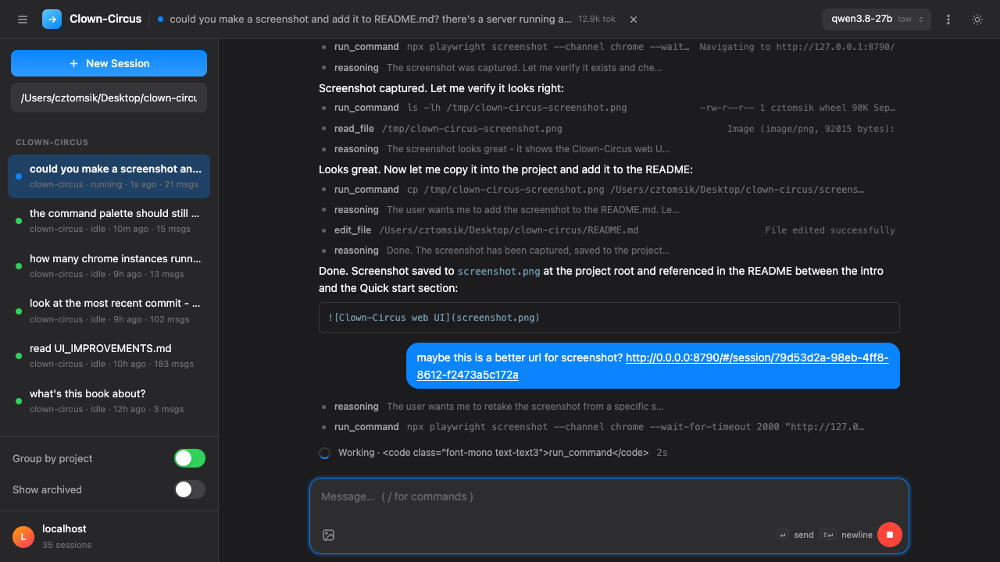

# Clown-Circus

A **headless, multi-session** port of [`clown-code`](https://github.com/cztomsik/clown-code) exposed as an
**Express** HTTP server with a **web UI** as its sole public interface.
Clown-Circus manages any number of independent agent **sessions** — each with
its own working directory, conversation state, and running agent loop — all
driven through the web UI (served at `/`), which is a pure client of the
server's internal REST + Server-Sent Events API. Every session and its full
conversation (one row per message) are persisted in a local **SQLite**
database, so state survives restarts.

- **Target runtime**: Node.js 24.x, TypeScript (`.ts`, ESM). The server has no build step (Node strips the types at runtime).
- **Storage**: the builtin `node:sqlite` module. No external DB server.
- **Dependencies**: `express` for the server; `esbuild` + `@tailwindcss/cli` (both build the web UI at startup) + the web UI's browser libraries (`preact`, `marked`, `dompurify`) — esbuild inlines them all into `webui/vendor/bundle.js` at startup, so the UI works offline (no CDN).
- **LLM**: any OpenAI-compatible `/v1/chat/completions` endpoint (llama.cpp by default).

See [`SPEC.md`](SPEC.md) for the full specification and [`WEB_UI.md`](WEB_UI.md) for the web UI.



---

## Quick start

```bash
npm install
npm start                # -> http://127.0.0.1:8790
```

Point it at your LLM (defaults to `http://127.0.0.1:8080`):

```bash
CLOWN_API=http://127.0.0.1:8080 npm start
```

Then open <http://127.0.0.1:8790> in your browser: create a session rooted at
a project directory (picking a model), send messages, and watch the agent run
live — slash commands, todos panel, and session actions and all.

---

## Configuration

CLI flags take precedence over environment variables, which take precedence over defaults.

| Flag / Env | Env fallback | Default | Meaning |
|---|---|---|---|
| `--port` / `PORT` | `PORT` | `8790` | HTTP listen port |
| `--host` / `HOST` | `HOST` | `127.0.0.1` | Bind address (localhost by default) |
| `--home` / `CLOWN_HOME` | `CLOWN_HOME` | `~/.clown` | Clown home dir: `clown.db` + `skills/` (created if missing) |
| `--base-url` / `CLOWN_API` | `CLOWN_API` | `http://127.0.0.1:8080` | LLM OpenAI-compatible base URL |
| `--timeout` / `CLOWN_TIMEOUT_MS` | `CLOWN_TIMEOUT_MS` | `900000` | Per-LLM-request timeout (ms) |

`CLOWN_API_KEY` (env, optional) is sent as a Bearer token on every LLM request.

---

## HTTP API (internal)

The server exposes a REST + SSE HTTP API (base path `/`; JSON
bodies/responses everywhere except the SSE endpoint; errors as
`{ "error": { "code", "message" } }`). It is **internal** — the web UI is
the sole public interface, and the API is not a stable contract: expect
endpoints to change. [`SPEC.md`](SPEC.md) §7 documents every endpoint,
request/response shape, and error code.

---

## Storage

A single SQLite **file** `clown.db` in the clown home dir (default `~/.clown`;
override the home with `--home`/`CLOWN_HOME`; a legacy `~/.clowndb` is migrated
in on the first run). The DB is the
system of record: each appended message is one `messages` row written the moment it exists,
and the `sessions` row is upserted on every other transition (create, status change, error,
delete). On startup all sessions are loaded into memory; any session persisted
as `running`/`stopped` (killed mid-run) is reset to `idle`.

Each message is one `messages` table row (`data` = the internal conversation
format) plus a `total_tokens` column on the session row. The system prompt is
*not* stored — it is derived from the session's `cwd` at load time and on
`/clear` (the todo list is *not* stored either; the web UI derives it from the
last `write_todos` tool call). The format may evolve freely as the tool grows.

---

## Tools

Relative paths resolve against the session's `cwd` (the same directory `run_command` runs in).
There is **no path sandbox**: the agent may read, write, and execute anywhere the server process can reach.

| Tool | Args | Notes |
|---|---|---|
| `read_file` | `path`, `raw?` | `N:content` line prefixes unless `raw`. 2MB cap. |
| `write_file` | `path`, `content` | Creates parent dirs. |
| `edit_file` | `path`, `old_content`, `new_content`, `replace_all?` | Exact-match replace. |
| `run_command` | `command`, `cwd?` | `sh -c`; captures stdout+stderr; abortable on stop. |
| `write_todos` | `content: string (markdown)` | No-op: the tool call's presence in the transcript IS the todo list (the web UI derives it from messages); returns "Todos updated". |

Skills (`<root>/<name>/SKILL.md` with a `description` frontmatter) are loaded
by the agent **via `read_file`** — no dedicated tool. Discovery roots,
highest precedence first: `<cwd>/.agents/skills/` → `~/.agents/skills/` →
`<home>/skills/`. The built-in `init` and `make_skill` skills are seeded
into `<home>/skills/<name>/` on first run; discovered skills are listed in
the system prompt so the model can route to them.

---

## Security notes

- Binds to `127.0.0.1` by default; single-user local tool (no auth).
- No path sandbox: file/shell tools can reach any path the server process can. The trust boundary is the local user plus the `127.0.0.1` bind.
- The LLM key is never logged; request bodies are not logged.
